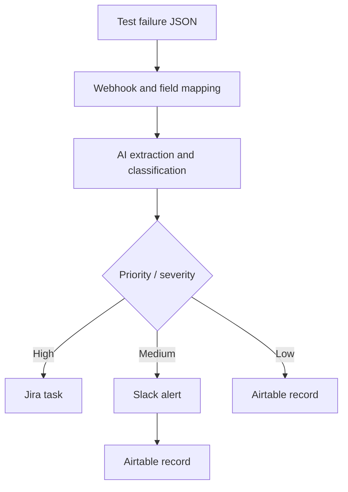

# Automated QE Test Failure Triage Workflow

**An n8n portfolio project  applies AI-assisted triage to a real software testing problem: deciding which automated test failures need attention and where to route them.**

## Purpose and intent

Automated regression suites can produce a mixture of critical failures, functional defects, cosmetic issues, and intermittent timeouts. Manually reading each stack trace delays the first triage decision and makes prioritization inconsistent.

I built this project to demonstrate how n8n can orchestrate a practical Quality Engineering workflow: receive a test failure, extract technical context, suggest priority and severity with an LLM, and route the result into engineering tools. The intended benefit is faster first-pass triage and less repetitive log review. Time savings, classification accuracy, and production impact have not been measured.

This repository showcases my ability to translate a testing problem into an automation design, connect APIs, use structured AI outputs, implement conditional routing, and create repeatable demonstration payloads. It is intended for technical discussion and sharing on LinkedIn.

## Demo context and account disclosure

- This is an independent portfolio demonstration using simulated test failures, not a client delivery or production deployment.
- **Contigo is a dummy company in the supplied materials.** Its customer-support prompts belong to a separate scenario and are not part of the QE workflow.
- The QE examples and presentation use **Volta / Volta Coffee Roasters as the demonstration application context**. Those names do not imply an employment, client, or endorsement relationship.
- Airtable and Jira were configured using my personal trial accounts. The Slack channel belongs to me.
- The public workflow removes credential references, account-specific resource IDs, pinned data, and instance metadata. Configure your own credentials and destinations before running it.

All example payloads use synthetic demonstration environment labels. Database errors and stack traces are illustrative fixtures, not operational logs.

## What the workflow does

1. Receives a JSON test failure through an HTTP POST webhook.
2. Maps the test metadata, error message, and stack trace in `Prepare`.
3. Uses an OpenRouter chat model to extract the failing component, failure domain, and probable root cause.
4. Uses a second model to suggest priority, severity, a bug title, an action, and a flakiness flag.
5. Validates the AI output structure with JSON schema parsers.
6. Applies a three-way priority/severity switch and calls the configured integrations.



### Current exported routing

| Condition, evaluated in order | Output | Implemented action |
| --- | --- | --- |
| Priority OR severity is `High` | 0 | Create a Jira issue |
| Otherwise, priority OR severity is `Medium` | 1 | Send Slack message, then create Airtable record |
| Otherwise | 2 | Create Airtable record |

**The current export sends high-priority failures to Jira only.** The original brief and presentation describe a broader target of Jira + Slack + Airtable. That fan-out remains a planned enhancement. The Jira configuration uses a Task issue type with `Bug:` in its summary, rather than a verified Bug issue type, label, or active-sprint assignment.

## Skills demonstrated

| Capability | Evidence in this project |
| --- | --- |
| QE process design | Failure intake, severity routing, and escalation scenarios |
| n8n orchestration | Webhook, field mapping, model chains, parsers, switch, integrations |
| Applied AI | Separate extraction and classification prompts with structured schemas |
| API integration | OpenRouter, Jira, Slack, and Airtable nodes |
| Test design | Ten synthetic failure scenarios and a PowerShell batch runner |
| Engineering judgment | Explicit distinction between expected behavior, observed evidence, and future work |

## Explore the project

| File or folder | Contents |
| --- | --- |
| [Workflow JSON](workflows/qe-test-failure-triage.json) | Sanitized importable n8n definition |
| [Setup guide](docs/setup.md) | Credentials, destination configuration, and execution |
| [Architecture](docs/architecture.md) | AI boundaries, schemas, and implementation details |
| [Validation notes](docs/validation.md) | Actual report findings and known limitations |
| [Examples](examples/) | Ten standalone JSON failure payloads |
| [PowerShell runner](scripts/runtests.ps1) | Batch webhook submission and HTML report generation |
| [Sample report](reports/sample-execution-report.html) | Historical HTTP submission results |
| [Presentation](docs/presentation/automated-qe-test-triage.pptx) | Original presentation with historical claims qualified by validation notes |
| [Slide transcript](docs/presentation/slide-text.md) | Searchable text from the presentation |
| [Original source notes](docs/source/) | Brief, partial baseline log, and design rationale |

## Quick start

1. Import `workflows/qe-test-failure-triage.json` into an n8n instance that supports the included nodes. The original n8n version was not supplied.
2. Configure your OpenRouter, Jira, Slack, and Airtable credentials and replace destination placeholders. Follow the [setup guide](docs/setup.md).
3. Keep the workflow inactive while reviewing it. Enable the production webhook only after configuring your sandbox integrations.
4. Send one sample to your webhook, for example on a local instance:

   ```bash
   curl -X POST http://localhost:5678/webhook/qe-test-triage \
     -H 'Content-Type: application/json' \
     --data-binary @examples/failure-01.json
   ```

5. Inspect the n8n execution and the destination record or issue. HTTP acceptance alone does not prove successful triage.
6. To submit all ten examples with PowerShell:

   ```powershell
   ./scripts/runtests.ps1 -WebhookUrl "http://localhost:5678/webhook/qe-test-triage" -ReportPath "./QE_Test_Triage_Report.html"
   ```

Running the workflow can create real Jira tasks, Slack messages, Airtable records, and model usage charges in your configured accounts.

## Validation and limitations

The supplied historical report records **10 submissions: 7 accepted and 3 failed with HTTP 404**. It does not assert actual route selection or destination creation. The earlier validation log is incomplete. No live end-to-end revalidation was performed when preparing this repository.

The models suggest a probable root cause and classification. Structured JSON validation does not establish factual accuracy. Prompt rules overlap in places, and a single timeout is insufficient evidence that a test is flaky. Human review remains necessary.

The original presentation mentions sub-two-second Jira creation and full auditability. The supplied evidence does not establish those claims. See [validation notes](docs/validation.md) before quoting results.

## Next steps

- Complete high-priority fan-out and log all branches consistently.
- Measure classification against human-labelled failures and resolve prompt conflicts.
- Add schema validation at intake, authentication, safe handling of untrusted log text, retries, and failure fallback.
- Add duplicate detection and idempotency before connecting a CI runner.
- Capture downstream assertions and execution timing, then evaluate a larger sample.

## Author

[Yogesh Deshmukh](https://github.com/yogeshdeshmukh86) . Quality Engineering and Test Management

Built to demonstrate practical n8n automation for software testing and to invite discussion about AI-assisted QE workflows.
