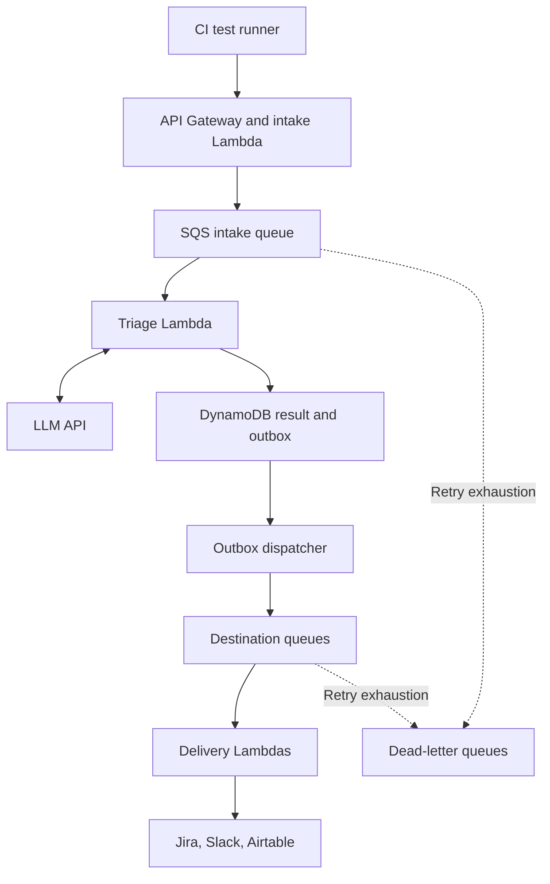

# Scaling roadmap and proposed cloud serverless architecture

**Status: design proposal.** The current implementation runs in local Docker using n8n. No cloud resources, infrastructure-as-code, load tests, or production deployment are included.

## Goals

Absorb bursts from parallel CI test suites, retain a traceable result for every accepted failure, prevent duplicate tickets, and isolate destination failures. Validate these goals before claiming performance improvements.

## Path 1: Scale the existing n8n implementation

Retain the visual workflow and move to managed container hosting with n8n queue mode, Redis, and PostgreSQL. Add workers as execution demand grows, and consider dedicated webhook processors behind a load balancer for higher intake volume.

This is a container-based deployment with persistent dependencies. Using managed container compute does not make the entire n8n stack a stateless function. n8n's internal Redis execution queue is distinct from an application intake queue such as SQS. Verify version compatibility and feature licensing before deployment.

Protect the editor separately from webhook intake. Store the shared n8n encryption key securely, back up PostgreSQL, and set worker concurrency according to model and destination API capacity. Follow the official [n8n queue-mode documentation](https://docs.n8n.io/hosting/scaling/queue-mode/).

## Path 2: Rebuild processing as a serverless event pipeline

The following AWS example is a proposed alternative implementation of the same triage logic. It requires new application code and deployment configuration. The n8n JSON cannot be deployed directly as a Lambda function.

### Component responsibilities

| Component | Proposed responsibility |
| --- | --- |
| API Gateway + intake Lambda | Authenticate, validate the versioned payload, enforce size limits, enqueue durably, then return an acceptance response with a correlation ID |
| SQS intake queue | Buffer bursts and separate request acceptance from completion |
| Triage Lambda | Redact sensitive fields, call extraction/classification models, validate output, and apply routing policy |
| DynamoDB | Persist event status, classification, deduplication keys, and delivery intent |
| Transactional outbox | Persist results and delivery intent together, then dispatch pending work through a retryable stream or polling consumer |
| Destination queues and delivery Lambdas | Separate Jira, Slack, and Airtable retries, rate limits, and failure handling |
| Dead-letter queues | Retain repeatedly failing messages for alerting, investigation, and controlled replay |
| S3, optional | Store large redacted stack traces with retention policies; pass references rather than large queue payloads |
| Secrets Manager and IAM | Store API credentials and grant each component only the permissions it needs |
| CloudWatch | Record correlated logs, delivery failures, queue age, latency, and cost-related metrics |

The outbox and per-destination delivery state are application features to implement. A queue alone does not guarantee exactly-once external side effects. If Jira succeeds but a worker loses its response, reconcile using a stable external event reference before retrying ticket creation.

### Processing contract

1. Assign a stable event key from project, test run ID, test case ID, and attempt number.
2. Accept only after durable enqueue. Acceptance is separate from classification and delivery completion.
3. Record processing state and reuse a persisted classification during delivery retries.
4. Commit the classification and outbox records atomically. Dispatch each intended destination independently.
5. Track delivery status and destination object IDs. Retry transient errors with backoff and jitter; honor API retry guidance.
6. Route invalid or exhausted events to review rather than silently dropping them. Replays reuse stable event and action keys.

SQS/Lambda processing can deliver messages more than once. Implement idempotent consumers and partial batch failure responses. See [AWS SQS/Lambda behavior](https://docs.aws.amazon.com/lambda/latest/dg/with-sqs.html) and [partial batch failure handling](https://docs.aws.amazon.com/lambda/latest/dg/services-sqs-errorhandling.html).

## Further scope and improvements

| Phase | Improvement | Completion evidence |
| --- | --- | --- |
| 1. Correctness | Resolve overlapping classification rules, define priority separately from severity, and add deterministic critical-error guards | Human-labelled evaluation set with per-class results |
| 1. Reliability | Complete High fan-out, persist all outcomes, and isolate Slack failure from Airtable logging | Asserted destination results including simulated API failures |
| 1. Input safety | Validate payload schema, authenticate webhooks, redact logs, and treat instructions in logs as untrusted data | Negative tests for malformed, oversized, and hostile payloads |
| 2. Integration | Connect CI runners and use stable event IDs, duplicate detection, and replay-safe delivery | Retries do not create additional Jira tasks |
| 2. Learning | Use repeated executions to assess flakiness; capture human severity corrections | Reproducibility history and reviewed feedback records |
| 3. Scale | Add buffering, bounded worker concurrency, provider-aware throttling, and dead-letter handling | Burst tests with measured queue age, processing latency, and error rates |
| 3. Operations | Add secret rotation, monitoring, data retention, backup/recovery tests, and budget alerts | Tested recovery and incident runbook |
| 4. Cloud delivery | Choose an n8n container path or a serverless rebuild; add infrastructure-as-code and staged deployments | Repeatable sandbox deployment and integration tests |

## Capacity and cost validation

Size concurrency against the slowest dependency, including LLM rate limits and Jira, Slack, and Airtable quotas. More workers can increase throttling and cost without improving useful throughput.

As a planning estimate, required processing concurrency is arrival rate multiplied by average processing time. Validate with measured distributions and representative bursts. Track end-to-end p50/p95 latency, oldest queued message, classification quality, duplicate actions, delivery failures, and cost per processed failure.

Keep Airtable as a demonstration or reporting destination when suitable; evaluate a durable cloud datastore as the system of record for larger workloads. Define retention and access policies for logs before uploading real test data.

No throughput, availability, latency, or cost target has been validated for this project.
